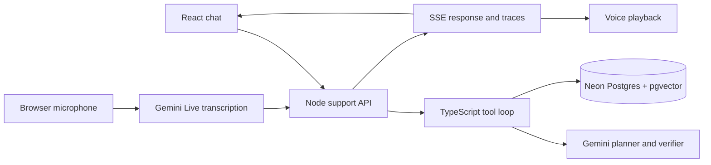

# Loopp Help Desk

Loopp is a customer support agent for a fictional SaaS workspace. It handles billing, subscriptions, account access, and workspace administration through streaming chat and interruptible voice. Both modes share conversation history, policy retrieval, and account controls. Refunds and human handoffs use simulated records.

## Reviewer scenarios

| Scenario | What to try | Expected behavior |
| --- | --- | --- |
| Grounded policy answer | “What is the upload size limit for a ZIP file?” | A streamed answer with a citation to the upload policy. |
| Multi-source retrieval | “How do I update my payment card and export workspace data?” | An answer that combines the two relevant policies and cites both. |
| Cross-mode refund | As Pro monthly, type “Please refund my last charge,” then say “Confirm refund” in voice mode. | The pending action carries across modes. The server rechecks eligibility and returns a mock refund reference after confirmation. |
| Voice interruption | Speak while the agent is reading a reply. | Playback stops and the next utterance enters the same conversation. |
| Human escalation | As Basic, ask for a refund. | The agent creates a ticket. An administrator can review it, accept or reject it, and send a reply. |
| Failure recovery | In **Observability**, simulate a tool failure on a policy question, then retry the turn. | The UI shows the failed step and retries with the same turn ID. |

## Architecture



- **Orchestration.** The server verifies the mock account and lets Gemini select a structured action from the transitions allowed at that step. Tool results inform the next decision. Gemini 3.5 Flash-Lite handles planning and verification, with Gemini 3.1 Flash-Lite available on a quota error. Refund preparation and explicit confirmation are separate turns. The server rechecks eligibility on confirmation, and a Postgres transaction prevents duplicate mock refunds.
- **Voice.** An AudioWorklet sends 16 kHz microphone audio to Gemini 3.5 Transcribe Live using a short-lived token. The browser displays interim captions and submits the voice turn automatically. In auto mode, Loopp speaks verified replies using Groq Orpheus first, Gemini 3.8 Flash TTS second, and browser speech if both cloud providers are unavailable. Speech onset interrupts playback. Raw microphone audio is not stored by Loopp.
- **Streaming and recovery.** Server-Sent Events carry tool status, text, audio events, and traces. The observability drawer shows routing decisions, retrieval scores, timing, and provider usage where reported. Session quotas and leases bound concurrent work. Provider deadlines and persisted turn IDs support recovery when a tool fails or a connection drops.
- **Identity and handoff.** Passcode access supports a reviewer walkthrough. Google OAuth can map verified accounts to Basic or Pro. Ticket APIs are restricted to the configured administrator. For customers with verified email addresses, ticket creation and admin replies enqueue notifications for delivery through Resend when configured.

## Retrieval and confidence

The active corpus contains **35 policy passages**. Policies are split by heading to keep conditions and exceptions together, with overlap for long sections. Gemini Embedding 2 produces 768-dimensional vectors. Neon pgvector ranks the active policy version by cosine similarity and filters for applicable tiers. Supplemental searches can retrieve distinct pieces of evidence for compound questions. Cross-tier searches are restricted to published material.

The main search must retrieve a passage at or above the calibrated **0.55 cosine threshold**. The planner selects retrieved source IDs, and an independent evidence check verifies that the selected passages together support the answer. Policy replies use the stored passage text. Refund preparation also checks a verbatim quote, and execution requires explicit confirmation. Insufficient evidence can produce a clarification or a ticket, depending on where the workflow stops. Provider failures follow a separate retry path.

The cosine score measures retrieval similarity. An accurate rank does not guarantee a correct answer: the planner can choose the wrong passage, or the evidence check can reject a valid one. Independent verification reduces unsupported answers at the cost of additional latency and occasional over-escalation.

## Evaluation

Live run against the active policy version, `2026-11-4`, using Gemini and Neon:

| Metric | Result | Measurement |
| --- | --- | --- |
| Embedding pairwise accuracy | **11/11 (100%)** | Relevant passage scored above a labeled plausible wrong passage. |
| Retrieval Hit@1 / Recall@5 | **100% / 100%** | The labeled source ranked first in all 11 single-source retrieval cases. |
| Retrieval MRR@5 / Precision@5 | **1.00 / 20%** | Each case had one labeled relevant source in the five-result list. |
| End-to-end answer accuracy | **13/16 (81.25%)** | Expected outcome, required facts, citations, and refund preparation, as applicable. |

The three unexpected escalations were a Basic-versus-Pro comparison, a Basic SAML question, and an eligible Pro refund. The verifier rejected the selected evidence in the first two cases. The refund failed the verbatim quote check. The earlier policy version scored 14/14 on its smaller suite. These results describe the labeled demo cases.

Local integration tests use embedded Postgres and pgvector with controlled provider responses. Chrome tests cover the reviewer interface, simulated voice input, interruption, and escalation review. The live evaluator requires Gemini credentials and a seeded Neon database.

## Reproduce

**Runtime:** Node.js 22.12+ on the 22.x line. Copy [`.env.example`](.env.example) to `.env` and supply `DATABASE_URL`, `GEMINI_API_KEY`, and `DEMO_PASSCODE`. Google OAuth, Groq playback, and Resend delivery are optional integrations configured through the same environment template. For Google OAuth, the callback is `/api/support` on `APP_ORIGIN`.

```sh
npm ci
npm run seed
```

Run `npm run dev:api` and `npm run dev` in separate terminals, then open [localhost:5173](http://localhost:5173/). The repo includes a Vite production build and Vercel configuration for the Node API.

```sh
npm run typecheck
npm test
npm run test:browser
npm run build
npm run eval -- --stage=embedding
npm run eval -- --stage=retrieval
npm run eval -- --stage=output
```

The live evaluator also accepts `--case=receipt` for a single case and `--calibrate` for the threshold sweep. The labeled fixtures are in [`scripts/eval-cases.ts`](scripts/eval-cases.ts).
