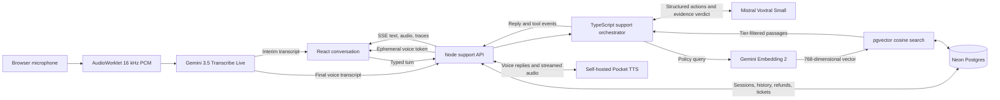

# Loopp Help Desk

Loopp is a customer support agent for a fictional SaaS workspace. It handles billing, subscriptions, account access, and workspace administration through streaming chat and interruptible voice. Both modes share conversation history, policy retrieval, and account controls. Refunds and human handoffs use simulated records.

## Reviewer scenarios

| Scenario | What to try | Expected behavior |
| --- | --- | --- |
| Grounded policy answer | “What is the upload size limit for a ZIP file?” | A streamed answer with a citation to the upload policy. |
| Multi-source retrieval | “How do I update my payment card and export workspace data?” | An answer that combines the two relevant policies and cites both. |
| Cross-mode refund | As Pro monthly, type “Please refund my last charge,” then say “Confirm refund” in voice mode. | The pending action carries across modes. The server rechecks eligibility and returns a mock refund reference after confirmation. |
| Voice interruption | Speak while the agent is reading a reply. | Playback stops and the next utterance enters the same conversation. |
| Human escalation | As Basic, ask for a refund. | The agent creates a ticket. An administrator can review it, accept or reject it, and send a reply. |
| Failure recovery | In **Observability**, simulate a tool failure on a policy question, then retry the turn. | The UI shows the failed step and retries with the same turn ID. |

## Current architecture



- **Support orchestration.** A bounded loop of up to six steps verifies the mock account and permits only the actions available at that stage. Mistral Voxtral Small (`voxtral-small-2507`) selects actions and evidence and checks whether the selected passages support the answer. The TypeScript handlers handle greetings, off-topic replies, clarification, policy lookup, escalation, and refunds. The planner can use up to four previous successful exchanges for the active account profile. Refund execution requires explicit confirmation and eligibility checks. A Postgres transaction protects against duplicate refunds.
- **Voice.** Gemini Live receives microphone audio over WebSocket using a short-lived token. The browser shows interim captions when the provider supplies them and requests English (`en-US`). A 700 ms silence window ends the local utterance. Muting stops new audio capture and preserves speech already captured. Loopp streams 24 kHz PCM from Pocket TTS for playback. Speaking interrupts the current reply, and the conversation keeps its scroll position while you read earlier messages. Raw microphone audio is sent to Gemini for transcription and is not stored by Loopp.
- **Streaming and recovery.** Server-Sent Events carry tool status, reply text, audio, timing, and provider usage where reported. Reply text is streamed after the orchestrator produces the verified answer. Voice errors leave the text reply available. Database-backed limits apply to login, voice-session creation, and support turns. Session leases bound concurrent turns. Retry uses the same turn ID to recover a saved result or retry a failed turn.
- **Identity and handoff.** Passcode access supports a reviewer walkthrough. Optional Google OAuth maps verified accounts to Basic or Pro. Administrator-only tools manage mock support tickets. When configured, Resend delivers notifications for customers with verified email addresses.

### Code layout

| Component | Implementation |
| --- | --- |
| Conversation, observability, and voice playback | [`src/main.tsx`](src/main.tsx), [`src/voice.ts`](src/voice.ts), [`public/mic-worklet.js`](public/mic-worklet.js) |
| Support routing and typed tools | [`src/agent.ts`](src/agent.ts), [`api/support.ts`](api/support.ts) |
| Planner, verifier, embeddings, and speech adapters | [`src/provider.ts`](src/provider.ts), [`src/live-transcription.ts`](src/live-transcription.ts), [`src/pocket-tts.ts`](src/pocket-tts.ts) |
| Policy corpus and persistence | [`src/policies.ts`](src/policies.ts), [`src/store.ts`](src/store.ts), [`scripts/schema.sql`](scripts/schema.sql) |

## Retrieval and confidence

The active corpus contains **35 policy passages**. Policies are split by heading to keep conditions and exceptions together, with overlap for long sections. Gemini Embedding 2 produces 768-dimensional vectors. Neon pgvector ranks the active policy version by cosine similarity and filters for applicable tiers. Supplemental searches can retrieve distinct pieces of evidence for compound questions. Cross-tier searches are restricted to published material.

The main search must retrieve a passage at or above the calibrated **0.55 cosine threshold**. The planner selects retrieved source IDs, and an independent evidence check verifies that the selected passages together support the answer. Policy replies use the stored passage text. Refund preparation also checks a verbatim quote, and execution requires explicit confirmation. Insufficient evidence can produce a clarification or a ticket, depending on where the workflow stops. Provider failures follow a separate retry path.

The cosine score measures retrieval similarity. An accurate rank does not guarantee a correct answer: the planner can choose the wrong passage, or the evidence check can reject a valid one. Independent verification reduces unsupported answers at the cost of additional latency and occasional over-escalation.

## Evaluation against the rubric

| Criterion | Evidence on this branch | Limits and pending checks |
| --- | --- | --- |
| **Agentic Architecture & Tool Orchestration (35%)** | Bounded action loop, typed tools, tier-scoped retrieval, cosine threshold, structured source selection, independent evidence check, and explicit refund confirmation. | The live run exposed one evidence-verification failure even though the labeled policy ranked first. |
| **Voice & Real-Time Streaming UX (25%)** | Live captions, streamed speech, input/output waveform, interruption, mute preserving captured text, and listening, transcribing, thinking, and speaking indicators. | Browser tests simulate transcription and audio events. Voice latency varies with providers and host CPU. |
| **Code Quality & System Design (25%)** | React UI, typed agent and provider adapters, and separate policy/persistence modules. Type checking, integration tests, and build are reproducible. | Type checking, 18 unit and integration tests, 8 Chrome tests, and the production build passed. |
| **Production Readiness (15%)** | Database-backed rate limits, concurrent turn leases, provider timeouts, recoverable turn IDs, and Vercel API configuration. | A deployed Pocket TTS service reachable by the API and a production smoke test are still pending. The reviewer scenarios provide a walkthrough outline. A recorded walkthrough was not found in this repo. |

### Assignment checklist

| Requirement | Status on this branch |
| --- | --- |
| Streaming chat with live tool status | Implemented. SSE carries tool start/completion events, answer text, and errors. |
| Live voice with waveform, captions, and interruption | Implemented locally. Gemini Live handles transcription and Pocket TTS streams speech. Chrome tests cover simulated voice turns, interruption, and mute. |
| Collapsible observability drawer | Shows prompt version, allowed and selected actions, retrieval and evidence decisions, token usage where reported, and request and voice timing. Shows a per-turn API estimate at standard list prices for priced planner, verifier, and embedding calls with reported usage. Live transcription is reported separately when available. The subtotal excludes live transcription, hosting, discounts, and free quotas. |
| Vector retrieval and grounding | Implemented with heading-based chunks, tier-filtered pgvector search, a cosine threshold, and separate evidence verification. |
| Multi-step tools and simulated execution | Implemented. Account verification, policy lookup, and mock refund or escalation are available in the support flow. Tool events stream as execution proceeds. |
| Error recovery and shared conversation memory | Implemented. Chat and voice use the same persisted turns and active-profile history. Provider timeouts, rate limits, and simulated tool failures surface retryable states. |

### Submission checklist

- **GitHub repository.** Full source, `.env.example`, and README are present in the workspace. Commit and push the reviewed branch, then verify the reviewer can access the link. Keep real credentials out of the commit.
- **Live prototype.** The repo contains a Vercel configuration. Verify a deployment of this version with reachable Pocket TTS, then run the chat, voice, and recovery scenarios on the deployed URL.
- **Loom walkthrough.** Record a 3–5 minute screen-and-webcam walkthrough showing live chat, voice interruption, a multi-step tool flow, and RAG and guardrails.
- **Submission email.** Reply in the assessment email thread within its seven-day window with the GitHub, live demo, and Loom links.

### Results

Live run on November 25, 2026 against policy version `2026-11-4`, using Voxtral Small, Gemini Embedding 2, and Neon.

| Metric | Result | Measurement |
| --- | --- | --- |
| Embedding pairwise accuracy | **100%** | The labeled source scored above the plausible wrong passage in every embedding case. |
| Retrieval Hit@1 / Recall@5 | **100% / 100%** | The labeled source ranked first in every scored single-source retrieval case. |
| Retrieval MRR@5 / Precision@5 | **1.00 / 20%** | The labeled passage ranked first for every evaluated query. With one labeled relevant passage per query and five returned results, Precision@5 was 20%. |
| End-to-end answer accuracy | **15/16 (93.75%)** | Checks outcome, required facts, citations, and refund preparation where applicable. |

Basic single sign-on was the only failing case. The correct policy ranked first, but evidence verification rejected the selected passages and the workflow escalated. The ambiguous billing case correctly asked for clarification in this run. On the four calibration fixtures, the 0.55 cutoff had zero false accepts and zero false rejects. This is a small labeled suite. The prior Voxtral run scored 14/16. The earlier Gemini-based run scored 13/16 on the same policy version.

The current branch passed TypeScript checking, 18 unit and integration tests, 8 Chrome tests, and the Vite production build. The live evaluator exited with a failure status because the Basic single sign-on case failed.

For the walkthrough, demonstrate a cited answer and its retrieval trace, interrupt a spoken reply, mute with a pending transcript, then simulate a tool failure and retry. Show an explicit refund confirmation or an admin ticket review to demonstrate a stateful tool flow.

## Reproduce

**Runtime:** Node.js 22.12+ on the 22.x line. Copy [`.env.example`](.env.example) to `.env` and supply `DATABASE_URL`, `GEMINI_API_KEY`, `MISTRAL_API_KEY`, and `DEMO_PASSCODE`. Set `MISTRAL_TEXT_MODEL` to override Voxtral Small. Google OAuth and Resend are optional. For Google OAuth, register `/api/support` on the exact `APP_ORIGIN` you are using. For local development, use `http://localhost:5173/api/support`.

```sh
npm ci
npm run seed
```

Run `npm run dev:api` and `npm run dev` in separate terminals, then open [localhost:5173](http://localhost:5173/). The repo includes a Vite production build and Vercel configuration for the Node API.

```sh
npm run typecheck
npm test
npm run test:browser
npm run build
npm run eval -- --stage=all
```

The live evaluator reads `.env`, uses Gemini for embeddings and Voxtral for planning and verification, and stubs out refunds and tickets. Run with `--stage=embedding`, `--stage=retrieval`, or `--stage=output` to isolate a stage. It also accepts `--case=receipt` for a single case and `--calibrate` for the threshold sweep. The labeled fixtures are in [`scripts/eval-cases.ts`](scripts/eval-cases.ts).


### Local speech output

Install and start the service in PowerShell:

```powershell
python -m venv .venv-pocket
.\.venv-pocket\Scripts\python.exe -m pip install pocket-tts==4.0.1
.\.venv-pocket\Scripts\pocket-tts.exe serve --host 127.0.0.1 --language english_2026-10 --default-voice eve
```

Without a Hugging Face login, Kyutai downloads its public preset-voice checkpoint and the Eve voice into the Hugging Face cache on first start. Set `POCKET_TTS_URL` if the TTS service listens on a different address. Its default is `http://127.0.0.1:8000/tts`. Leave the service running while testing voice replies.


### Hosted voice deployment

The Vercel configuration builds the React frontend and deploys the Node API. For hosted speech, run Pocket TTS as a separate CPU service, keep the model loaded, and set the Vercel project's `POCKET_TTS_URL` to the service's reachable `/tts` URL. The localhost default is for development. Before release, verify service access controls, streaming through the deployed API, and real microphone-to-speaker behavior. Confirm slow turns fit within the configured 60-second Vercel function duration, since the planner and voice stream have separate deadlines.
